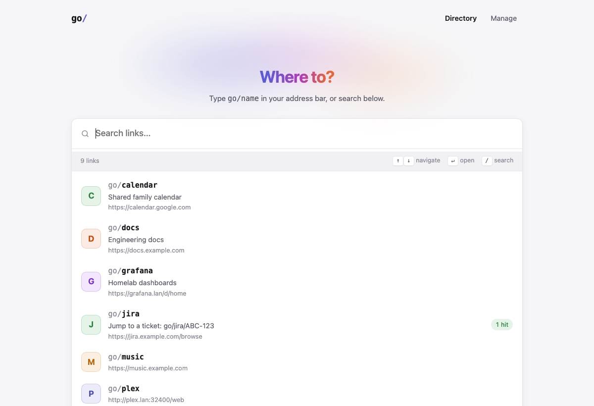
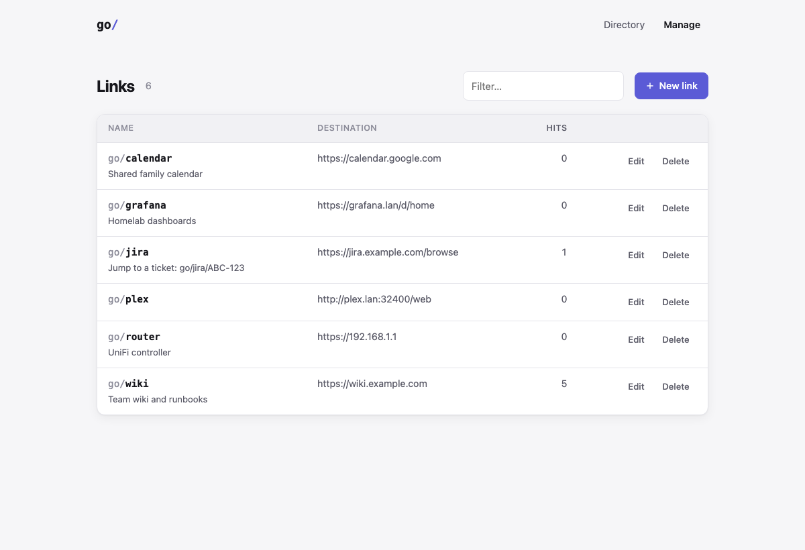
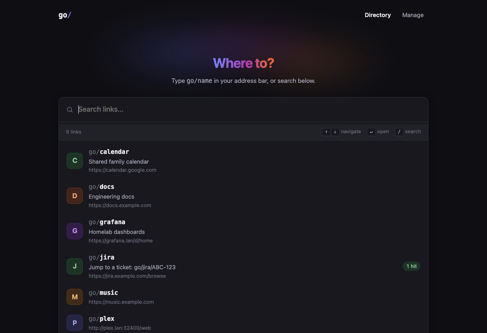

# httpgo

**Self-hosted go links.** Type `go/wiki` in your browser and land on your wiki.
A small, fast, single-container service for your home lab or team.



- **Short links:** `go/name` redirects anywhere
- **Path passthrough:** `go/jira/ABC-123` → `https://jira.example.com/browse/ABC-123`
- **Instant search:** command-palette directory with keyboard navigation (`/`, `↑` `↓`, `↵`)
- **"Create it" on miss:** visit a link that doesn't exist and you're one click from creating it
- **Admin auth:** a first-run setup page for the admin account, or SSO via any OpenID Connect provider
- **REST API** with bearer tokens for scripting
- **Zero dependencies to run:** SQLite, one container, light and dark themes, works without JavaScript

| Manage | Dark mode |
| --- | --- |
|  |  |

## Quick start

```sh
docker run -d --name httpgo -p 80:8080 -v httpgo-data:/data mattintech/httpgo
```

Point the hostname `go` at that machine (see [DNS](#making-go-resolve)), open <http://go/admin>,
and create your admin account. Browsing and using links never needs a login; only adding,
editing and deleting them does.

> The setup page is open to whoever reaches it first, so finish setup right after starting
> the container. httpgo is meant for private networks, not the public internet.

Or use Docker Compose: copy [`.env.example`](.env.example) to `.env`, adjust it if needed, and run
`docker compose up -d` with the included [`docker-compose.yml`](docker-compose.yml).

## Using links

| You type | You get |
| --- | --- |
| `go/` | The searchable directory |
| `go/wiki` | The URL saved for `wiki` |
| `go/wiki/some/page` | That URL with `/some/page` appended |
| `go/wiki?q=x` | Query strings are passed through |
| `go/wiki+` | Details for the link: destination, hits, dates |

For more control over where the extra path goes, put `{*}` in the destination URL:
`https://search.example.com/?q={*}` turns `go/search/cats` into `…/?q=cats`.

Names are case-insensitive and may contain letters, numbers, `-` and `_`.

## Making `go` resolve

Every device needs `go` to resolve to the server. Pick whichever fits your network:

- **Router / Pi-hole / AdGuard / Unbound:** add a local DNS record `go` → server IP.
  If your network has a search domain (e.g. `lan`), a record for `go.lan` works too.
- **Single machine:** add `192.168.1.10  go` to `/etc/hosts`.
- **Tailscale:** use [MagicDNS](https://tailscale.com/kb/1081/magicdns) and name the machine `go`.

Browsers sometimes treat `go/foo` as a search the first time. Visit `http://go/` once and
they'll remember it's a site.

## Configuration

All settings are environment variables.

| Variable | Default | Description |
| --- | --- | --- |
| `AUTH_MODE` | `password` | `password`, `oidc`, or `none` (no login at all). Protects `/admin` only; the directory and redirects stay public. |
| `ADMIN_USERNAME` | `admin` | Username, when the password comes from the environment |
| `ADMIN_PASSWORD` | | Set the admin password from the environment instead of the setup page |
| `ADMIN_PASSWORD_HASH` | | Alternative to `ADMIN_PASSWORD`; a Werkzeug hash (see below) |
| `ADMIN_API_TOKEN` | | Extra bearer token for `/admin/api/*`, in addition to one generated in Settings |
| `OIDC_DISCOVERY_URL` | | Provider's `.well-known/openid-configuration` URL |
| `OIDC_CLIENT_ID` / `OIDC_CLIENT_SECRET` | | From your provider |
| `OIDC_PROVIDER_NAME` | `SSO` | Shown on the sign-in button |
| `OIDC_SCOPES` | `openid email profile` | |
| `ADMIN_EMAILS` | | Comma-separated emails allowed to manage links |
| `ADMIN_EMAIL_DOMAINS` | | Comma-separated domains allowed to manage links |
| `OIDC_ALLOW_ANY_USER` | `false` | Allow any account the provider authenticates. Only for private providers. |
| `DATABASE_PATH` | `/data/golinks.db` | SQLite file |
| `SQLITE_JOURNAL_MODE` | `WAL` | Set to `DELETE` if `/data` is on NFS or SMB, where SQLite's WAL mode isn't supported |
| `SECRET_KEY` | auto | Session signing key. Generated and saved next to the database if unset. |
| `SITE_NAME` | `go` | Shown in the UI as `go/` |
| `PORT` | `8080` | Listen port inside the container |
| `WORKERS` / `THREADS` | `2` / `4` | Gunicorn tuning |
| `TRUSTED_PROXIES` | `0` | Number of reverse proxies in front (enables `X-Forwarded-*`) |
| `SESSION_COOKIE_SECURE` | `false` | Set `true` when served over HTTPS |

### Password auth (default)

On first start, open `/admin` and you'll be taken to a setup page to create the admin account.
After that, **Settings** lets you change the password (which signs out other devices) and
generate an API token.

For config-managed or automated deployments, you can set the account from the environment
instead. The setup page is then skipped and the password can't be changed in the UI:

```sh
ADMIN_USERNAME=admin
ADMIN_PASSWORD=change-me
```

To avoid keeping the plain password in your config, store a hash instead:

```sh
docker run --rm -it mattintech/httpgo python -c \
  "from werkzeug.security import generate_password_hash as h; print(h(input('Password: ')))"
```

and set `ADMIN_PASSWORD_HASH` to the output. Escape each `$` as `$$` in Compose files.

Repeated failed logins from one IP are throttled.

To turn sign-in off entirely on a fully trusted network, set `AUTH_MODE=none`.

**Forgot the password?** Delete the account so the setup page comes back:

```sh
docker exec httpgo python -c "import sqlite3; c = sqlite3.connect('/data/golinks.db'); \
  c.execute(\"DELETE FROM settings WHERE key LIKE 'admin_%'\"); c.commit()"
```

### Single sign-on (OIDC)

Works with any OpenID Connect provider: Google, Microsoft Entra ID, Okta, Authentik,
Keycloak, Authelia, Zitadel and others. Register a web application with the redirect URI
`http://go/auth/callback` (or your HTTPS URL), then:

```sh
AUTH_MODE=oidc
OIDC_DISCOVERY_URL=https://accounts.google.com/.well-known/openid-configuration
OIDC_CLIENT_ID=...
OIDC_CLIENT_SECRET=...
OIDC_PROVIDER_NAME=Google
ADMIN_EMAIL_DOMAINS=example.com
```

You must set `ADMIN_EMAILS` or `ADMIN_EMAIL_DOMAINS`. Without them, *any* Google account
could manage your links. Some providers, including Google, only allow HTTPS redirect URIs
for non-localhost hosts. In that case, serve httpgo behind a TLS reverse proxy and set
`TRUSTED_PROXIES=1` and `SESSION_COOKIE_SECURE=true`.

## API

```sh
TOKEN=...   # generate one under Settings
curl -H "Authorization: Bearer $TOKEN" http://go/admin/api/links
curl -H "Authorization: Bearer $TOKEN" -H 'Content-Type: application/json' \
     -d '{"shortname":"wiki","url":"https://wiki.example.com","description":"Team wiki"}' \
     http://go/admin/api/links
```

| Method | Path | |
| --- | --- | --- |
| `GET` | `/api/search?q=` | Public search |
| `GET` | `/admin/api/links` | List |
| `POST` | `/admin/api/links` | Create (`201`, or `409` if it exists) |
| `GET` | `/admin/api/links/<name>` | Fetch one |
| `PUT` / `PATCH` | `/admin/api/links/<name>` | Update `url` and/or `description` |
| `DELETE` | `/admin/api/links/<name>` | Delete (`204`) |
| `GET` | `/healthz` | Health check |

## Development

```sh
python -m venv .venv && . .venv/bin/activate
pip install -r requirements-dev.txt
pytest
python run.py            # http://127.0.0.1:8080
HTTPGO_DEBUG=1 python run.py   # auto-reload + debugger (local only)
```

The app is plain Flask + SQLite, with server-rendered templates, one CSS file and one JS
file. There is no build step.

## Releases

Images are published to Docker Hub as [`mattintech/httpgo`](https://hub.docker.com/r/mattintech/httpgo):

| Tag | Built from |
| --- | --- |
| `latest` | `main`, the stable channel |
| `X.Y.Z`, `X.Y` | release tags |
| `develop` | the `develop` branch. Newest changes, may break. |

Work happens on `develop`; it's merged to `main` when stable.

## License

[MIT](LICENSE)
